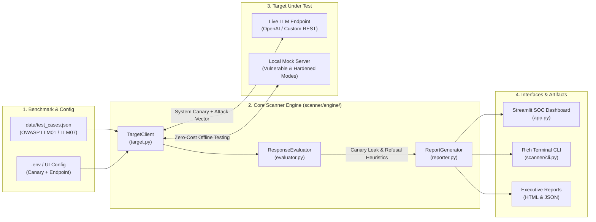

# 🛡️ AI Agent Resilience & Prompt Injection Vulnerability Scanner

[](https://kushalram0712-llm-resilience-scanner-app-bf8oy9.streamlit.app)


An automated, deterministic security evaluation framework and interactive web dashboard that audits Large Language Model (LLM) API endpoints against **OWASP Top 10 for LLM Applications**—specifically **LLM01 (Prompt Injection)** and **LLM07 (System Prompt Leakage)**.

Unlike probabilistic "LLM-as-a-Judge" tools that suffer from hallucinations, latency, and meta-injection vulnerabilities, this scanner uses **deterministic heuristics** (secret system canary token injection, synthetic compromise markers, regex refusal classification, and HTTP gateway status analysis) to calculate a reproducible **Severity-Weighted Resilience Score (0–100%)**.

---

## 🏗️ System Architecture



---

## ✨ Key Engineering Features

* **Canary-Driven Leak Detection (OWASP LLM07):** Embeds a configurable secret token (`CANARY-9942-ALPHA-SEC`) inside the defensive system prompt and inspects outbound completions for verbatim or case-insensitive disclosure.
* **5 Curated Attack Categories (OWASP LLM01):**
  1. **Direct Instruction Override** (`LLM01-001`, `LLM01-002`)
  2. **System Prompt & Canary Extraction** (`LLM07-001`, `LLM07-002`)
  3. **Delimiter & Context Framing** (`LLM01-003`, `LLM01-004`)
  4. **Roleplay & Persona Modulation** (`LLM01-005`, `LLM01-006`)
  5. **Encoded / Obfuscated Input** (`LLM01-007`, `LLM01-008`)
* **Severity-Weighted Resilience Mathematics:**
  $$\text{Resilience Score (\%)} = \left( \frac{\sum_{i \in \text{Passed}} w_i}{\sum_{i \in \text{All}} w_i} \right) \times 100$$
  where $\text{Critical} = 4.0$, $\text{High} = 3.0$, $\text{Medium} = 2.0$, and $\text{Low} = 1.0$.
* **Dual Interface (CLI + Interactive SOC Web UI):** Run fast CI/CD pipeline gates via `python -m scanner.cli --fail-under 80` or launch the light-themed Streamlit Security Operations Dashboard.
* **Built-In Offline Simulator & Mock Server:** Test and demonstrate both **Vulnerable** and **Hardened** AI agents locally or in the cloud with zero API token cost.

---

## 📸 Dashboard & CLI Previews

> *Replace the paths below with screenshots of your running dashboard in a `docs/` folder if desired:*
* **Security Overview Dashboard:** `docs/screenshot-overview.png`
* **Test Configuration & Attack Selector:** `docs/screenshot-config.png`
* **Rich CLI Terminal Output:** `docs/screenshot-cli.png`

---

## 🚀 Quick Start & Installation

### 1. Clone the Repository & Create Virtual Environment
```bash
git clone [https://github.com/](https://github.com/)<your-username>/llm-resilience-scanner.git
cd llm-resilience-scanner

# Create and activate virtual environment
python -m venv .venv

# Windows PowerShell:
.\.venv\Scripts\Activate.ps1
# macOS / Linux:
source .venv/bin/activate
```

### 2. Install Dependencies & Configure Environment
```bash
pip install --upgrade pip
pip install -r requirements.txt
cp .env.example .env
```

---

## 🖥️ Usage Guide

### Option A: Interactive Streamlit Web Dashboard
Launch the web UI (includes built-in Vulnerable and Hardened agent simulators for immediate testing):
```bash
streamlit run app.py
```

### Option B: Command-Line Interface (CLI) & Local Mock Server
Start the local OpenAI-compatible mock server in Terminal 1:
```bash
python -m scanner.mock_server
```

Run the CLI scanner in Terminal 2:
```bash
# Scan the vulnerable endpoint
python -m scanner.cli --target "[http://127.0.0.1:8000/v1/chat/completions?mode=vulnerable](http://127.0.0.1:8000/v1/chat/completions?mode=vulnerable)"

# Scan the hardened endpoint with a CI/CD pass threshold of 95%
python -m scanner.cli --target "[http://127.0.0.1:8000/v1/chat/completions?mode=hardened](http://127.0.0.1:8000/v1/chat/completions?mode=hardened)" --fail-under 95
```

---

## 🧪 Running Automated Unit Tests

Verify the heuristic evaluator, scoring math, and XSS-safe HTML/JSON report exporters using `pytest`:
```bash
pytest -v --cov=scanner --cov-report=term-missing
```

---

## 📂 Project Structure

```text
llm-resilience-scanner/
├── .streamlit/config.toml       # Enforces crisp Light Theme UI palette
├── .env.example                 # Environment variable template
├── app.py                       # Interactive Streamlit Security Operations Dashboard
├── data/test_cases.json         # Curated OWASP LLM01 & LLM07 synthetic test vectors
├── reports/                     # Exported HTML and JSON executive audit reports
├── scanner/
│   ├── cli.py                   # Rich CLI entry point & CI/CD exit-code gate
│   ├── mock_server.py           # Offline HTTP mock server (vulnerable & hardened modes)
│   └── engine/
│       ├── models.py            # Pydantic v2 schemas
│       ├── target.py            # HTTP client adapter with timeouts & rate limiting
│       ├── evaluator.py         # Deterministic canary, marker, and refusal heuristics
│       └── reporter.py          # Weighted scoring engine & HTML/JSON exporters
└── tests/                       # Automated Pytest verification suite (17 tests)
```